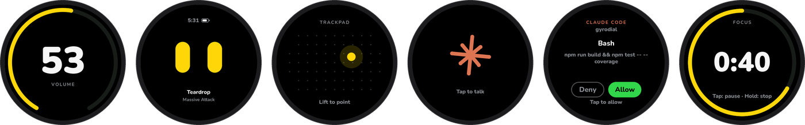
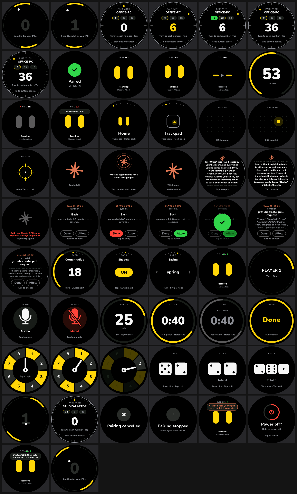

# gyrodial

**A palm-sized round dial for your Windows PC.** Turn it for volume. Flip its face to a trackpad, a
focus timer, or Claude. Approve Claude Code's permission prompts from your desk.

[](https://github.com/tank104/gyrodial/actions/workflows/build.yml)
[](https://github.com/tank104/gyrodial/releases/latest)
[](LICENSE)



It runs on the **Waveshare ESP32-S3-Touch-AMOLED-1.75C** (about US$40, nothing to solder). It has no
knob: the whole puck is the dial, and its gyro senses the turn. That's where the name comes from.
The device and its tray app are both called **Puck**.

gyrodial is a Windows take on [Watt, the puck](https://watt.sourabhdaroji.com/) by Sourabh Daroji,
which is Mac-only. It's a separate implementation, with the firmware and app written from scratch, and
it isn't affiliated with Watt. It does speak the same page protocol as
[`dialkit-watt`](https://github.com/gizmofalcon/dialkit-watt), so that npm package works with it
unchanged.

> **Status:** early. Everything here has been built and tested on one board. Bug reports, and results
> from other boards, are very welcome.

## Get started

You need the board, a USB-C data cable, and Windows 10 (version 2004) or later on x64.

1. **Get the board:** the [Waveshare ESP32-S3-Touch-AMOLED-1.75C](https://www.waveshare.com/esp32-s3-touch-amoled-1.75c.htm). A LiPo battery is optional.
2. **Get the app:** download `Puck-<version>-win-x64.zip` from the
   [latest release](https://github.com/tank104/gyrodial/releases/latest), unzip it anywhere, and run
   `Puck.exe`. It's self-contained, so there's nothing else to install. The app isn't code-signed yet,
   so Windows SmartScreen may warn you the first time: choose *More info → Run anyway*.
3. **Install the firmware**, either way:
   - **From the app:** plug the board in, then go to *Settings → Firmware*.
   - **From your browser:** open the [web installer](https://tank104.github.io/gyrodial/) in Chrome or Edge, and click Install.
4. **Pair:** the puck shows a few numbers. Turn it to each one and tap. After that, it connects on
   its own, over USB or Bluetooth.

If the board won't connect for flashing, hold **BOOT** while plugging it in. Flashing replaces what's
on the board; [here's how to back it up first](docs/HARDWARE.md#backing-up-the-board).

## What it does

| On the puck | What happens |
|---|---|
| **Turn** it (on the home face) | System volume, with a big number and a ring. Tap: play/pause. Swipe left/right: previous/next track. Hold: mute. |
| **Side button** | Opens the face picker: turn to choose, tap to pick, hold to go back. On the faces the PC brings up (DialKit, game, Teams) it goes back. While pairing, it cancels. Held (on battery): power off. |
| **Trackpad** face, flat on the desk | The glass moves the pointer, and "up" stays up even after you turn the puck. Tap clicks. Hold or two-finger tap right-clicks. Two fingers scroll. Double-tap-and-drag drags. Turning also scrolls. |
| Trackpad face, **lifted** | Air mouse: aim at the screen with your hand's rotation, tap to click. |
| **Claude** face | Tap, talk, tap to send. Your PC turns your voice into text (Windows speech recognition), and only the text goes to Claude. Turn to scroll the reply. |
| **Claude Code** asks for permission | The puck switches to the approval face. Nothing is selected at first: turn clockwise for Allow or anticlockwise for Deny, then tap. Swipe up/down to read a long command. |
| **DialKit** page in focus (localhost) | Turn to tune the selected knob, swipe for the next one, tap to toggle/run. |
| **Teams** meeting | Tap to mute or unmute. Turn for volume. |
| **Focus** | Turn to set minutes, tap to start. Chimes when it's done, and Windows shows a notification. |
| **Spin**, **Dice** | Tap to spin or roll (or shake for dice). |
| No PC connected | It plays circular **Pong**. |

<details>
<summary>See every face (rendered by the desktop simulator)</summary>



</details>

## How it works

```
 ┌──────────── the puck (ESP32-S3) ────────────┐        ┌──────────── Windows ─────────────┐
 │ 466×466 AMOLED · touch · IMU · PMU · speaker │  USB   │ Puck.exe (tray)                  │
 │ faces: home/volume, trackpad, pointer,       │◄──────►│  volume · media · mouse          │
 │ Claude, approvals, DialKit, game, call,      │  or    │  Claude voice chat               │
 │ focus, spin, dice, pong, pairing             │  BLE   │  Claude Code hook (puck-hook.exe)│
 └──────────────────────────────────────────────┘ NDJSON │  DialKit / games (ws :47824)     │
                                                         │  Teams meeting mute              │
                                                         └──────────────────────────────────┘
```

The puck and the app talk in newline-delimited JSON, over the board's USB serial port or over
Bluetooth LE. [docs/PROTOCOL.md](docs/PROTOCOL.md) describes every
message, so you can write your own host or face.

## Setting up the integrations

All of them are in **Settings → Integrations** in the tray app.

- **Claude:** paste your Anthropic API key in Settings → Claude (it's stored encrypted with Windows
  DPAPI). Puck also uses `ANTHROPIC_API_KEY` if that's set. The model defaults to
  `claude-opus-5-5` and can be changed there. For the best dictation, turn on
  *Settings → Privacy & security → Speech → Online speech recognition* in Windows. Without it, Puck
  falls back to offline recognition.
- **Claude Code approvals:** click *Install Claude Code hook*. This adds a `PermissionRequest` hook
  (and a `Notification` hook) to `%USERPROFILE%\.claude\settings.json` (or `CLAUDE_CONFIG_DIR`), after
  taking a backup, so that they run `puck-hook.exe`. The installer refuses to edit a file with
  comments or anything else it doesn't expect. When the puck isn't connected, the hook stays silent
  and Claude Code asks in the terminal as usual.

  The hook only trusts the Puck app. Each answer is signed with a per-user key in
  `%AppData%\Puck\hook.key`, and proxies are bypassed. The app's local endpoint refuses requests from
  web pages.
- **DialKit:** in your dev app, `npm install dialkit-watt` and add `<WattBridge />` next to
  `<DialRoot />`. Puck listens on `ws://127.0.0.1:47824/bridge`, and only accepts pages served from
  localhost.
- **Microsoft Teams:** turn it on, then in Teams go to *Settings → Privacy → Manage API* and enable
  the third-party app API. The first time you press mute on the puck during a meeting, Teams asks you
  to allow Puck.

## Building from source

You need [ESP-IDF v5.5](https://docs.espressif.com/projects/esp-idf/en/v5.5.3/esp32s3/get-started/windows-setup.html)
for the firmware and the [.NET 10 SDK](https://dotnet.microsoft.com/download) for the app.

```powershell
./scripts/build.ps1          # firmware + app → dist/Puck-win-x64.zip
cd firmware; idf.py -p COM5 flash   # flash your own build (in an ESP-IDF shell; use your board's port)
```

[CONTRIBUTING.md](CONTRIBUTING.md) covers the rest: building piece by piece, the tests, the face
simulator (see every face without a board), and the repository layout.

## More

- [docs/PROTOCOL.md](docs/PROTOCOL.md): the wire protocol between the puck and the app.
- [docs/HARDWARE.md](docs/HARDWARE.md): the board, what to change if yours behaves differently,
  diagnostics, logs and backups.
- [CONTRIBUTING.md](CONTRIBUTING.md): how to build, test and send a pull request.
- [SECURITY.md](SECURITY.md): how to report a vulnerability privately.

## Contributing

Issues and pull requests are welcome. Please read [CONTRIBUTING.md](CONTRIBUTING.md) first. For
anything bigger than a fix, open an issue to talk it through before you start.

## Credits

- [Watt, the puck](https://watt.sourabhdaroji.com/) by Sourabh Daroji, for the idea and the interaction design this follows.
- [DialKit](https://www.npmjs.com/package/dialkit) by Josh Puckett, and [`dialkit-watt`](https://github.com/gizmofalcon/dialkit-watt) (MIT).
- Waveshare's board examples, and [ESP-IDF](https://github.com/espressif/esp-idf) (its NimBLE host, and the ES8311 register sequence). [LVGL](https://lvgl.io), [cJSON](https://github.com/DaveGamble/cJSON) (as shipped in ESP-IDF), [NAudio](https://github.com/naudio/NAudio), and [ESP Web Tools](https://esphome.github.io/esp-web-tools/). The touch, IMU and PMU register sequences are ported from [SensorLib and XPowersLib](https://github.com/lewisxhe) (MIT).
- The [Nunito](https://github.com/googlefonts/nunito) typeface (SIL Open Font License).

## License

MIT, see [LICENSE](LICENSE). The Nunito font files keep their own license
(`firmware/tools/fonts/OFL.txt`), and the ported driver files credit SensorLib and XPowersLib in
their headers.

gyrodial isn't affiliated with Watt, Waveshare, Anthropic or Microsoft. Product names are
trademarks of their owners.
